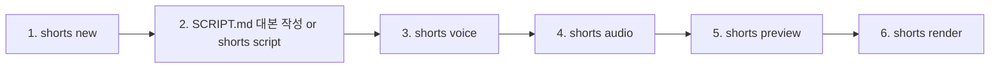

# Claude Animated Shorts Engine (Standalone CLI) — v2.0.0

Three.js + Remotion + Python DSP 오디오 엔진 기반 **2D-in-3D 애니메이션 쇼츠 생성 엔진**입니다.
복잡한 수작업 복사와 의존성 중복을 제거하고, 대본 작성부터 음성 합성(TTS), 단어 정렬(STT), 사운드 믹스, 3D 렌더링, 최종 2K 비디오 제작까지 **통합 CLI(`shorts`)**로 원클릭 자동화합니다.

---

## 🚀 빠른 시작 (Quick Start)

### 1. 사전 환경 준비
- **Node.js**: v18 이상
- **Python**: 3.10 이상
- **FFmpeg**: PATH 등록 필요
- **Google Chrome**: Remotion 렌더러용

### 2. 의존성 설치
```bash
# 1) Core 렌더러 의존성 설치
cd packages/core
npm install
cd ../..

# 2) Python 오디오 & 음성 합성 의존성 설치
pip install numpy scipy edge-tts

# (선택) Whisper 초정밀 단어 정렬기를 사용할 경우
pip install openai-whisper
```

### 3. CLI 전역 등록 (선택)
```bash
npm link
# 이제 어디서나 `shorts` 명령어를 직접 사용할 수 있습니다.
# (또는 프로젝트 루트에서 `node ./cli/bin/shorts.mjs`로 실행)
```

---

## 🎬 쇼츠 제작 워크플로우

### 🌟 초간단 방법: 주제만 던지면 대본부터 렌더링까지 전자동 완성 (추천!)
```bash
# Gemini, OpenAI, Claude 중 하나의 API 키가 설정되어 있으면 AI가 Style Bible 공식에 맞춰 대본까지 완벽 작성합니다.
export GEMINI_API_KEY="your-api-key"   # 또는 OPENAI_API_KEY / ANTHROPIC_API_KEY

shorts create my-titanic-story --topic "타이타닉 침몰 원인 중 연철 리벳의 결함 이야기" --2k
```
- **프로젝트 생성** ➡️ **대본 AI 작성** ➡️ **음성(TTS) 합성** ➡️ **단어 타임스탬프(STT)** ➡️ **BGM Ducking 믹스** ➡️ **2K 3D 렌더링**이 한 번에 끝납니다!

---

### 단계별 커스텀 제작 방법 (필요 시)



#### Step 1. 새 프로젝트 생성
```bash
shorts new my-story
```

#### Step 2. 대본 생성 (AI 자동 작성 또는 수동 작성)
```bash
# AI로 대본 자동 작성
shorts script my-story --topic "74명의 군인이 발맞춰 걷다가 무너진 1831년 브로턴 다리"
```

### Step 3. 음성(TTS) 및 단어 타임스탬프(STT) 자동 생성
```bash
shorts voice my-first-short
```
- `SCRIPT.md`를 읽어 무료 고품질 Azure Neural Voice(`edge-tts`)로 성우 음성 `voice.wav`를 생성합니다.
- 발화 분석 엔진(Whisper or Energy VAD)이 0.01초 단위의 단어별 시작/종료 시점(`words.json`)을 자동 추출합니다.

### Step 4. 사운드트랙 & SFX 자동 덕킹 믹스
```bash
shorts audio my-first-short
```
- 발걸음, 충격음, 물소리 등 물리 기반 SFX를 합성합니다.
- `words.json` 발화 타이밍을 기준으로 목소리가 나오는 동안 BGM을 자동으로 -3 dB 낮추는 **Speech Ducking** 및 마스터 리미터(-15 LUFS)가 적용된 `projects/my-first-short/out/mix.wav`가 완성됩니다.

### Step 5. 3D 씬 연출 및 스틸컷 프리뷰
`projects/my-first-short/scene/`의 `story.ts`(카메라 앵글), `build.ts`(마을/건물 배치), `cast.ts`(캐릭터 동작)를 수정한 뒤 스틸컷을 미리 확인합니다:
```bash
# 100프레임, 400프레임 스틸컷 렌더링
shorts preview my-first-short 100,400
```
- `projects/my-first-short/out/preview_100.jpg`, `preview_400.jpg`로 즉시 시각 확인이 가능합니다.

### Step 6. 최종 2K 영상 렌더링 & 오디오 먹싱
```bash
# 1080x1920 기본 렌더
shorts render my-first-short

# 유튜브/틱톡 고화질용 2K 세로 렌더 (1440x2560)
shorts render my-first-short --2k
```
- Three.js + Remotion 렌더러가 GPU 가속으로 3D 애니메이션 비디오를 렌더링하고, 오디오(`mix.wav`)와 자동 결합하여 최종 마스터 비디오 `projects/my-first-short/out/final.mp4`를 출력합니다!

---

## 🛠️ 부가 유틸리티 명령어

| 명령어 | 설명 |
|---|---|
| `shorts qa <name>` | 렌더링된 비디오의 블랙 프레임, 프리즈 프레임 및 라우드니스(-15 LUFS) 품질 검증 |
| `shorts clean` | Remotion Webpack 임시 번들 폴더(`remotion-webpack-bundle-*`) 안전 정리 (디스크 절약) |

---

## 📂 디렉토리 구조

```
claude-animated-shorts/
├── cli/bin/shorts.mjs                # 통합 CLI 실행기
├── packages/
│   ├── core/                         # 공통 Three.js 셰이더 및 Remotion 렌더러 (1회 설치)
│   ├── audio/                        # Python DSP 및 신디사이저 엔진 (cartoon_audio)
│   └── voice/                        # TTS(edge-tts) 및 STT(Whisper) 자동화 파이프라인
├── projects/                         # 각 쇼츠별 독립 프로젝트 (< 50 KB)
│   ├── bridge-1831/                  # 브릿지 예제 쇼츠
│   └── my-first-short/               # 사용자 신규 쇼츠
│       ├── SCRIPT.md                 # 대본
│       ├── voice/                    # voice.wav, words.json
│       ├── scene/                    # story.ts, build.ts, cast.ts
│       └── out/                      # mix.wav, final.mp4
├── CHANGELOG.md                      # 버전 이력 및 백로그
└── AGENTS.md                         # AI 에이전트 작업 지침
```
